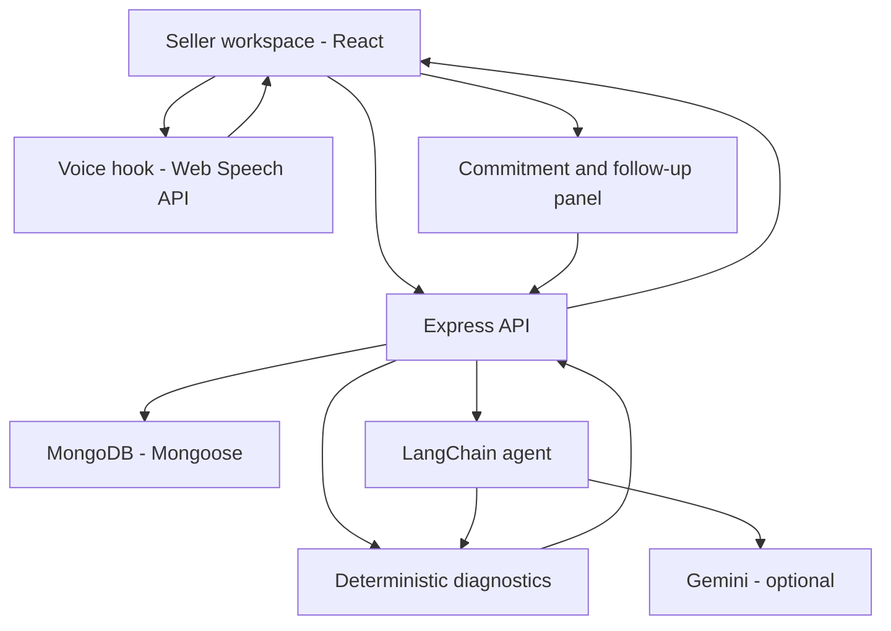

# AI, Voice and Product Design Note

## 1. Product objective

The Virtual KAM is designed to behave like a practical seller success manager rather than a generic question-answering chatbot. Its job is to move a seller from an unclear symptom (“sales are down”) to an evidence-backed diagnosis, a small number of prioritized actions, explicit ownership and a follow-up conversation.

The prototype intentionally uses synthetic seller data. It does not authenticate a real seller or write to Snapdeal systems.

## 2. Architecture

### Frontend

React presents the seller's metrics, diagnosis, SKU evidence, recovery actions and conversation. The voice hook captures one utterance at a time in `en-IN` and speaks the response using the browser's speech synthesis. Text input remains available when the browser does not support speech recognition or microphone access is declined.

### Backend

Express validates request inputs, loads the seller and conversation, runs the diagnostic service, invokes the agent and persists messages. Mongoose stores seller snapshots, conversations and seller-approved commitments.

### Agent orchestration

LangChain JS assembles the system prompt, recent conversation history and structured seller context. Gemini is used for natural-language understanding and response phrasing. A Zod schema constrains the response to a known intent and reply shape. If the model call fails or no API key is configured, a deterministic fallback handles the core diagnosis, clarification, recommendation and commitment flow.

## 3. Why calculations are deterministic

The LLM is not trusted to calculate business KPIs. The backend computes:

- Revenue, order and visit percentage change against the previous 30-day snapshot.
- Conversion as orders divided by visits, shown both as a rate and as a percentage-point movement.
- Average order value as revenue divided by orders.
- Availability, cancellation, rating and return risk signals.
- SKU-level stock risks, ranked by recorded views.
- Recovery actions with first steps, owners, timelines and success measures.

This keeps arithmetic reproducible and makes the agent explainable. The sample case shows revenue down 31.9%, visits down 15.0%, conversion moving from 3.00% to 2.40% (down 0.60 percentage points), while average order value remains ₹1,200. That points to both a traffic problem and a conversion problem, not simply a lower basket value.

The account health number is explicitly labelled a directional demo heuristic. It is not represented as an official Snapdeal score or a calibrated prediction.

## 4. Diagnosis and action prioritization

The action order reflects the seller's ability to fulfil demand:

1. **Availability:** restore stock on high-intent SKUs and reconcile physical stock with listed quantities.
2. **Cancellations:** identify inventory mismatch, dispatch delays and capacity constraints before driving more demand.
3. **Qualified traffic:** improve titles, attributes, listing status and primary images on available products.
4. **Conversion:** review like-for-like pricing, product information, delivery promise and buyer objections.
5. **Customer experience:** review low ratings and returns for product-quality, packaging, fulfilment or expectation mismatch.

The agent avoids blanket discounts and additional ad spend until inventory and fulfilment are understood. A seller should not pay to attract traffic to a product that cannot be shipped.

## 5. Agent ownership and follow-up

The conversation is structured around five stages:

- **Diagnose:** summarize the strongest metrics and likely pressure points.
- **Clarify:** ask one focused question that changes the action plan.
- **Recommend:** propose a prioritized next step with an owner, timeline and measurable outcome.
- **Commit:** persist an action only when the seller explicitly states what they will do and supplies a clear future due date.
- **Follow up:** retain the commitment, show its due date and follow-up date, and let the seller trigger a check-in. The check-in becomes part of the conversation so the seller can report completion or a blocker.

Commitment extraction is deterministic. A model response alone cannot create a seller commitment. This is a deliberate human-in-the-loop guardrail.

The current prototype does not run a background scheduler or send notifications. The follow-up is an in-app check-in initiated by the seller; a production version could add scheduled reminders after explicit opt-in.

## 6. Voice design

- Speech recognition: browser `SpeechRecognition` / `webkitSpeechRecognition`, configured for `en-IN`.
- Speech output: `SpeechSynthesisUtterance`, configured for `en-IN`.
- Turn-taking: one utterance is captured at a time; the KAM speaks after the API returns.
- Fallback: typed conversation is available if voice is unsupported or permission is denied.

Browser voice support is not uniform. Chrome or Edge on localhost or HTTPS is recommended for the recording. The demo should show the microphone permission prompt and one complete spoken seller turn.

## 7. Safety, trust and scope boundaries

- Synthetic account and product data are labelled in the UI.
- The agent cannot claim that it changed seller inventory, listings, pricing, campaigns or orders.
- The LLM receives computed facts and is instructed not to invent policies, metrics or competitor information.
- The backend validates seller IDs, conversation IDs, message length, commitment status and due dates.
- Commitments are recorded only from explicit seller language with an unambiguous future due date.
- No seller credentials, payment details or real customer personal data are used.

## 8. Fit with seller operations

The prototype's diagnostic categories map to the seller workflows exposed in Snapdeal's public Seller API documentation: inventory, pricing, order management and returns. The seller report summary API documents sales, advertising spend, conversions, funds, clicks and impressions. Those are useful integration points for a future authenticated data adapter; this demo does not call them or claim access to a seller account.

Reference documentation:

- [Snapdeal Seller API picker](https://sellerapis.snapdeal.com/reference/api-picker)
- [Seller report summary v2](https://sellerapis.snapdeal.com/reference/sellerreportsummaryv2)

## 9. Production path

A production implementation would need authenticated seller identity, role-based authorization, approved Snapdeal API integrations, read/write scopes per action, idempotency keys, action previews, seller confirmation for consequential changes, immutable audit events, retry and rollback strategies, scheduled follow-up workers, notification preferences, observability, rate limiting and privacy/retention controls.

The current demo proves the interaction and decision-support loop. It does not pretend that marketplace execution or automated notifications are already integrated.
